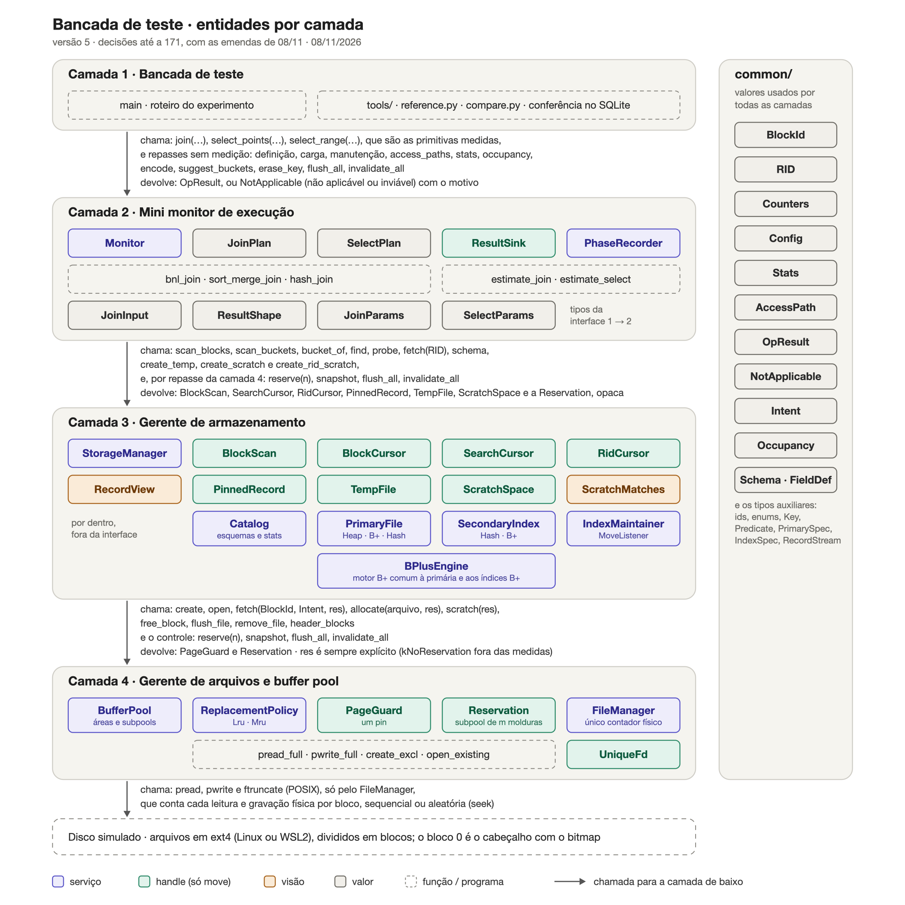

# Grupo-2---Avaliacao-2---SBD---UFRJ

Repositório com o trabalho da Avaliação 2 de Construção de Banco de Dados (2026.2) da UFRJ, do professor Milton R. Ramirez: uma bancada de teste que mede quantos blocos cada operação relacional transfere entre os arquivos do banco e o buffer pool, sob diferentes configurações do gerente de armazenamento.

O [gate de correção](docs/CI.md) verifica builds, testes com GoogleTest,
ASan/UBSan e uma rodada reduzida conferida com SQLite. A documentação explica
como torná-lo obrigatório para merges no GitHub.
Há também uma [suíte pequena de comparação de I/O](docs/IO.md) e uma
[avaliação do consumo do GitHub Actions](docs/CUSTO_ACTIONS.md).

- [1. Contexto](#1-contexto)
- [2. Objetivo](#2-objetivo)
- [3. Como rodar a bancada](#3-como-rodar-a-bancada)
- [4. Resultados](#4-resultados)
- [5. Limitações conhecidas](#5-limitações-conhecidas)
- [6. Mapa do repositório](#6-mapa-do-repositório)

## 1. Contexto

O enunciado ([PDF, versão de 04/11/2026](PrototipoIA/Avaliacao_2_v2_Indexacao_e_Processamento_de_Consultas.pdf)) pede que o grupo construa, com auxílio de IA, um mini SGBD em quatro camadas. Cada camada usa só a interface da camada de baixo:

| Camada | Papel | No código |
|---|---|---|
| 1. Bancada de teste | Gera a base, monta cada configuração, executa as operações, repete as medidas e grava os CSVs | `src/layer1/bench.cpp` |
| 2. Mini monitor de execução | Uma primitiva por algoritmo: BNL, sort-merge e hash join; seleção por varredura, por busca na estrutura ou por índice + fetch. O caminho de acesso é escolhido pelo experimento; não há SQL nem otimizador | `src/layer2/` |
| 3. Gerente de armazenamento | Organizações primárias (heap, B+, hash estático), índices secundários (hash, B+ e B+ clustering) e um mini catálogo | `src/layer3/` |
| 4. Gerente de arquivos e buffer pool | Blocos de 4 KB lidos e gravados com `pread`/`pwrite`. Buffer pool com áreas separadas e políticas LRU e MRU. Conta cada leitura e gravação, separando as sequenciais das aleatórias | `src/layer4/` |



A métrica central é o **número de blocos transferidos** entre os arquivos do motor e o buffer pool, contado em cada `pread` e `pwrite` do gerente de arquivos. Não é E/S física do SSD: o cache de páginas do sistema operacional pode atender a leitura, e os seeks são classificados (sequencial × aleatório), não observados. Por isso o tempo de relógio é registrado só como informação complementar. Cada medida tem ao lado o custo estimado pelas fórmulas dos livros-texto (Silberschatz e afins), calculado com os parâmetros medidos pela própria bancada. Cada resultado é conferido contra o SQLite, em número de linhas e checksum.

O código em `PrototipoIA/Implementacao/` é um **protótipo gerado por IA (Claude)**, ainda sem revisão completa do grupo. O log de prompts está em [`PROMPTS.md`](PrototipoIA/Implementacao/PROMPTS.md). A arquitetura e as decisões que guiaram a geração estão em [`HANDOFF_ARQUITETURA_2026-11-08.md`](PrototipoIA/HANDOFF_ARQUITETURA_2026-11-08.md). As decisões 172 a 175 vêm da auditoria de 10/11/2026.

## 2. Objetivo

Responder com medidas: **qual configuração do SGBD processa melhor uma dada carga de trabalho sobre uma dada base?** Para isso, a bancada compara:

- **Organizações primárias:** heap; B+ por campo UNIQUE e por NOT UNIQUE; hash estático por campo UNIQUE e por NOT UNIQUE.
- **Métodos de acesso:**
  - varredura;
  - busca pela organização primária;
  - índice secundário hash (campo UNIQUE) e B+ (campo NOT UNIQUE) sobre o heap;
  - índice B+ clustering sobre B+ e sobre hash.
- **Algoritmos de junção:** nested-loop em blocos (BNL), sort-merge e partition-hash, este com particionamento recursivo.
- **Situações (fatores):**

| Fator | Níveis |
|---|---|
| Tipo de seleção | igualdade em UNIQUE e faixa em NOT UNIQUE (obrigatórias); faixa em UNIQUE (opcional, mantida) |
| Seletividade da seleção | pontual (1 registro por chave, em lotes de 1.000 chaves); cerca de 1%; cerca de 50% |
| Configuração da seleção | a: sem índice; b: pelo campo da organização primária; c: por índice secundário |
| Tipo de junção | NATURAL JOIN (PK–FK, obrigatório); equijoin em campos UNIQUE e em campos NOT UNIQUE (opcionais, mantidos) |
| Tamanho das tabelas da junção | menor ⋈ menor; menor ⋈ maior; maior ⋈ maior. "Menor" é a tabela que cabe na área de trabalho: b ≤ M − 2 = 30 blocos |
| Configuração da junção | a: nenhuma tabela com índice; b: uma organizada pelo campo da junção; c: as duas organizadas pelo campo; d: uma organizada e a outra com índice secundário; e: as duas com índice secundário |
| Ordem das entradas | externa × interna (build × probe no hash) |
| Política de substituição | LRU e MRU, medidas lado a lado; a escolha para cada teste está na §4.4 |

Células da matriz do enunciado que não fazem sentido, como uma faixa sobre hash, aparecem no resultado como `nao_aplicavel`, junto com o motivo (casos 1 a 4, decisão 170).

## 3. Como rodar a bancada

### Pré-requisitos

- **Sistema POSIX:** macOS, Linux ou WSL2. A E/S usa `pread` e `pwrite`, então não roda no Windows nativo.
- **Compilador C++20:** testado com Apple clang 21 e GCC 13 no Linux. O CI usa GCC no Ubuntu 24.04.
- **Build:** `make`, ou CMake 3.20+.
- **Python 3:** só a biblioteca padrão, incluindo o módulo `sqlite3`.
- **Disco:** cerca de 120 MB livres para uma rodada completa. A maior parte é a base gerada e os arquivos do motor.

### Passo a passo

1. Clone o repositório e entre na pasta do código:

   ```bash
   git clone git@github.com:Feharia/Grupo-2---Avaliacao-2---SBD---UFRJ.git
   cd Grupo-2---Avaliacao-2---SBD---UFRJ/PrototipoIA/Implementacao
   ```

2. Compile. Isso gera `build/bancada` e `build/testes`; leva uns 4 s com `-j8`.

   ```bash
   make -j8
   ```

3. Rode os testes: são 67, das camadas 2, 3 e 4. Para rodar os mesmos testes com AddressSanitizer e UBSan, use `make asan`. O CI exige GoogleTest real; o comando `make test` mantém o shim local.

   ```bash
   make test
   ```

4. Faça uma rodada rápida (escala 0,1 e 1 repetição) para conferir que tudo funciona. Em poucos segundos ela gera a base, mede, confere com o SQLite e grava as tabelas em `saida_rapida/tabelas.md`. A última linha do `compare.py` deve dizer `divergências: 0`.

   ```bash
   make rapido
   ```

5. Faça a rodada completa (escala 1, de 3 a 10 repetições por combinação, LRU e MRU). Leva uns 40 s.

   ```bash
   ./build/bancada --saida saida
   ```

6. Gere a referência no SQLite (uns 5 s) e confira as linhas e os checksums. O `compare.py` termina com código 1 se alguma linha divergir.

   ```bash
   python3 -I tools/reference.py saida
   python3 -I tools/compare.py saida
   ```

7. Gere as tabelas de análise, em `saida/tabelas.md` e `saida/tabelas/*.csv`:

   ```bash
   python3 -I tools/tabelas.py saida
   ```

   Para gerar as tabelas principais com a outra política, use `python3 -I tools/tabelas.py saida --politica MRU`.

Com CMake, o build fica em outra pasta:

```bash
cmake -S . -B build-cmake && cmake --build build-cmake && ctest --test-dir build-cmake
```

As opções da bancada estão no [README do protótipo](PrototipoIA/Implementacao/README.md#como-rodar):
- `--escala`;
- `--reps-min` e `--reps-max`;
- `--tolerancia`;
- `--politicas`;
- `--m-juncao` e `--m-selecao`;
- `--lote`;
- `--so`, para rodar só algumas operações;
- `--tuplas`, para conferir tupla a tupla.

### O que a bancada grava

| Arquivo em `saida/` | Conteúdo |
|---|---|
| `resultados.csv` | Uma linha por política, operação, variante, algoritmo e repetição. Traz a posição na matriz (tipo, tamanho, configuração, seletividade), o status e o motivo, as leituras e gravações (sequenciais e aleatórias), as requisições e os acertos, o custo estimado e o tempo |
| `fases.csv` | E/S de cada fase: runs, passes, particionamento, build/probe |
| `convergencia.csv` | Para cada grupo de repetições: quantas rodaram, a dispersão de E/S e de tempo e se cada critério convergiu ou se a parada foi pelo teto |
| `caminhos.csv` | O acesso que cada algoritmo realmente executou em cada entrada |
| `estatisticas.csv`, `ocupacao.csv` | Parâmetros medidos de cada estrutura e a ocupação antes e depois da carga de manutenção |
| `constantes.csv` | Limites de cada faixa, com a seletividade pedida e a efetiva |
| `referencia.csv`, `conferencia.txt` | Resultado do SQLite e da conferência |
| `tabelas.md`, `tabelas/*.csv` | As 16 tabelas de análise do `tabelas.py` |
| `manifesto.txt` | Commit, compilador, flags, escala, semente, parâmetros e duração |

## 4. Resultados

Os números abaixo vêm da rodada completa em [`resultados_exemplo/`](PrototipoIA/Implementacao/resultados_exemplo/):
- escala 1, política LRU;
- M = 32 molduras nas junções e M = 2 nas seleções;
- de 3 a 10 repetições por combinação.

As 534 linhas medidas batem com o SQLite. Todas as 16 tabelas estão em [`resultados_exemplo/tabelas.md`](PrototipoIA/Implementacao/resultados_exemplo/tabelas.md). Uma rodada nova reproduz as mesmas contagens de blocos; só o tempo e o nº de repetições mudam.

**A base** é o esquema de universidade do enunciado:

| Tabela | Registros | Bytes por registro | Registros por bloco | Blocos (heap) |
|---|---:|---:|---:|---:|
| Aluno | 20.000 | 127 | 31 | 646 |
| Inscrição | 100.000 | 64 | 59 | 1.695 |
| Detalhes | 20.000 | até 256 (VarChar) | 15 pelo máximo, cerca de 37 na média | 542 |
| Turma | 6.000 | 24 | 145 | 42 |
| Disciplina | 800 | 52 | 72 | 12 |
| Curso | 200 | 122 | 32 | 7 |

As B+ foram carregadas com 70% de ocupação, e por isso têm mais blocos que o heap: Aluno tem 952 folhas e Inscrição tem 2.439. Curso e Disciplina também existem organizadas por B+ (9 e 16 folhas) e por hash (11 e 17 buckets), para as junções entre tabelas pequenas.

### 4.1 Cobertura da matriz do enunciado

A tabela "Cobertura da matriz" do `tabelas.py` confere cada célula do enunciado v2 contra o `resultados.csv`:

| Grupo | Células | Executadas | Não aplicáveis | Ausentes |
|---|---:|---:|---:|---:|
| Obrigatórias (NATURAL JOIN, igualdade em UNIQUE, faixa em NOT UNIQUE) | 60 | 54 | 6 (caso 3) | **0** |
| Opcionais (equijoins, faixa em UNIQUE) | 96 | 10 | 56 | 30 não implementadas |

As 15 células do NATURAL JOIN (3 tamanhos × 5 configurações) rodam com os três algoritmos.

### 4.2 Seleções: organização primária × método de acesso

Blocos transferidos pela mesma consulta em cada organização e caminho. Em negrito, o menor custo da linha; "n/a" é uma célula que não se aplica.

| Consulta | Selet. | Heap (varredura) | B+ primária | Hash primário | Heap + hash sec. | Heap + B+ sec. | B+ prim. + clustering | Hash prim. + clustering |
|---|---|---:|---:|---|---:|---:|---:|---:|
| igualdade em UNIQUE: cpf | pontual | 321.360 |  |  | **1.992** |  |  |  |
| igualdade em UNIQUE: dre | pontual | 326.680 | 3.041 | **1.008** |  |  |  |  |
| faixa em UNIQUE: dre | 1% | 646 | **12** | n/a (caso 4) |  |  |  |  |
| faixa em UNIQUE: dre | 50% | 646 | **479** | n/a (caso 4) |  |  |  |  |
| faixa em NOT UNIQUE: cr | 1% | 646 |  |  |  | **201** |  |  |
| faixa em NOT UNIQUE: cr | 50% | **646** |  |  |  | 9.700 |  |  |
| faixa em NOT UNIQUE: curso | 1% | 646 | 13 | n/a (caso 4) |  |  | 13 | **10** |
| faixa em NOT UNIQUE: curso | 50% | 646 | **477** | n/a (caso 4) |  |  | **477** | 668 |

A faixa é feita de grupos inteiros de valores iguais (decisão 174): as seletividades efetivas são 1,00% (dre), 1,00% (cr) e 1,03% (curso, campo com só 200 valores), e de 49,84% a 50,00% no nível alto.

**O que a tabela mostra**

- **Igualdade (1.000 chaves por lote):**
  - Sem índice, cada chave custa em média metade do heap, cerca de 323 blocos.
  - O hash primário custa 1,01 bloco por chave; a B+ primária, 3,04. Com as páginas de índice dentro de M = 2 (decisão 172), cada chave lê a descida inteira (raiz, nó interno e folha), como na fórmula h + 1. Por isso, para igualdade, o hash ganha da B+ por 3×.
  - O hash secundário custa 2,0 blocos por chave: o bucket do índice e depois o bloco de dados. Contra a varredura, os índices reduzem o custo de 107 a 324 vezes.
- **Faixa estreita (1%):**
  - Os índices ganham da varredura: a B+ primária lê 12 blocos contra 646 (54×), e o clustering sobre hash lê 10.
  - O índice secundário não clustering ainda ganha, mas por pouco: 201 blocos contra 646 (3,2×). Já são 199 registros, e cada um custa um acesso aleatório.
  - O hash primário não responde a faixa, porque não preserva a ordem das chaves.
- **Faixa larga (50%):**
  - O índice secundário não clustering **perde** da varredura: 9.700 blocos contra 646, 15 vezes mais. Cada um dos 9.976 registros vira um acesso aleatório a um bloco de dados; nesta rodada, os RIDs não são ordenados antes do fetch.
  - A B+ primária ainda ganha (479 × 646), mas só por 1,35×, porque as folhas ficam 70% cheias.
- **Clustering sobre B+ × clustering sobre hash:**
  - Com 1%, os dois custam quase o mesmo (13 × 10 blocos).
  - Com 50%, o clustering sobre B+ lê 477 blocos, 99% em sequência. Sobre hash, lê 668 blocos, todos aleatórios. O hash por curso, campo com poucos valores distintos, tem 580 blocos de overflow para 211 buckets.

### 4.3 Junções: o melhor algoritmo depende da situação

Total de blocos de cada algoritmo, na melhor ordem externa/interna, com M = 32. Em negrito, o vencedor.

| Junção | Tamanho | Config. | Entradas | BNL | Sort-merge | Hash | Vencedor |
|---|---|---|---|---:|---:|---:|---|
| Curso ⋈ Disciplina | menor ⋈ menor | a | heap ⋈ heap | **19** | 57 | **19** | BNL = hash |
| Curso ⋈ Disciplina | menor ⋈ menor | b | B+ (codigo) ⋈ heap | **21** | 46 | **21** | BNL = hash |
| Curso ⋈ Disciplina | menor ⋈ menor | c | B+ (codigo) ⋈ B+ (curso) | **25** | 27 | **25** | BNL = hash |
| Curso ⋈ Disciplina | menor ⋈ menor | c | hash (codigo) ⋈ hash (curso) | **28** | 66 | **28** | BNL = hash |
| Curso ⋈ Disciplina | menor ⋈ menor | d | B+ (codigo) ⋈ heap + B+ sec. (curso) | **21** | 46 | **21** | BNL = hash |
| Curso ⋈ Disciplina | menor ⋈ menor | e | heap + hash sec. ⋈ heap + B+ sec. | **19** | 57 | **19** | BNL = hash |
| Curso ⋈ Aluno | menor ⋈ maior | a | heap ⋈ heap | **653** | 1.983 | **653** | BNL = hash |
| Curso ⋈ Aluno | menor ⋈ maior | b | heap ⋈ B+ (curso) | **959** | 975 | **959** | BNL = hash |
| Curso ⋈ Aluno | menor ⋈ maior | c | B+ (codigo) ⋈ B+ (curso) | **961** | 964 | **961** | BNL = hash |
| Curso ⋈ Aluno | menor ⋈ maior | c | hash (codigo) ⋈ hash (curso) | **802** | 2.132 | **802** | BNL = hash |
| Curso ⋈ Aluno | menor ⋈ maior | d | B+ (codigo) ⋈ heap + B+ sec. (curso) | **655** | 1.972 | **655** | BNL = hash |
| Curso ⋈ Aluno | menor ⋈ maior | e | heap + hash sec. ⋈ heap + B+ sec. | **653** | 1.983 | **653** | BNL = hash |
| Aluno ⋈ Inscrição | maior ⋈ maior | a | heap ⋈ heap | 70.141 | 10.483 | **7.075** | hash (1,48×) |
| Aluno ⋈ Inscrição | maior ⋈ maior | b | B+ (dre) ⋈ heap | 102.652 | 9.475 | **7.381** | hash (1,28×) |
| Aluno ⋈ Inscrição | maior ⋈ maior | c | B+ (dre) ⋈ B+ (dre) | 147.292 | **3.395** | 8.125 | sort-merge (2,39×) |
| Aluno ⋈ Inscrição | maior ⋈ maior | c | hash (dre) ⋈ hash (dre) | 147.840 | 11.662 | **4.840** | hash (2,41×) |
| Aluno ⋈ Inscrição | maior ⋈ maior | d | B+ (dre) ⋈ heap + B+ sec. (dre) | 102.652 | 9.475 | **7.381** | hash (1,28×) |
| Aluno ⋈ Inscrição | maior ⋈ maior | e | heap + hash sec. ⋈ heap + B+ sec. | 70.141 | 10.483 | **7.075** | hash (1,48×) |
| Aluno ⋈ Detalhes (opcional) | maior ⋈ maior | a | heap ⋈ heap | 22.506 | 4.892 | **3.624** | hash (1,35×) |
| Aluno ⋈ Turma (opcional) | maior ⋈ maior | e | heap + B+ sec. ⋈ heap + B+ sec. | 1.980 | 1.956 | **1.940** | hash (1,01×) |

O número entre parênteses é quanto o 2º colocado custa em relação ao vencedor.

**O que a tabela mostra**

- **Uma tabela pequena muda tudo.** Quando uma das tabelas cabe em M − 2 blocos, BNL e hash leem cada tabela uma vez só (b_r + b_s) e empatam em todas as 12 células menor ⋈ menor e menor ⋈ maior. O sort-merge custa até 3 vezes mais, porque ordena e grava runs. A exceção é quando as duas entradas já estão em ordem (B+ × B+): aí o sort-merge só intercala e quase empata (27 × 25; 964 × 961).
- **Com duas tabelas grandes, o BNL custa de 6 a 43 vezes o vencedor.** Ele relê a interna inteira para cada bloco de 16 páginas da externa: 646 + 41 × 1.695 = 70.141. A exceção é Aluno ⋈ Turma: Turma tem só 42 blocos, e o BNL empata com os outros.
- **Com heaps (configuração a), o hash join vence o sort-merge.** São 7.075 blocos contra 10.483: o hash particiona uma vez (cerca de 3·(b_r + b_s)), enquanto o sort-merge grava runs e ainda faz um passe de intercalação.
- **A organização primária pode decidir o vencedor:**
  - Duas B+ pelo campo da junção dispensam a ordenação: o sort-merge só intercala as folhas (3.395 = 952 + 2.439 + 4 da descida até a primeira folha de cada árvore) e ganha do hash por 2,4×.
  - Dois hash pelo campo poupam particionamento: o hash join usa os buckets de Inscrição como partições, só particiona Aluno e ganha do sort-merge por 2,4×.
  - Já para o BNL, as B+ pioram, porque as folhas a 70% somam mais blocos que o heap.
- **O índice secundário não clustering não ajuda nenhum dos três algoritmos.** BNL, sort-merge e partition-hash leem a organização primária inteira (tabela "Acesso executado nas junções"). Por isso a configuração e custa o mesmo que a a nos três tamanhos, e a d custa o mesmo que a b sempre que as duas têm a mesma organização primária (P×P e G×G).

**A ordem das entradas pesa no hash join.** Com Aluno (646 blocos) como build, cada partição cabe na memória: 7.075 blocos. Com Inscrição (1.695 blocos) como build, as partições não cabem, e o hash join faz 32 passes de particionamento recursivo: 12.035 blocos, ou +70,1%. No BNL e no sort-merge, trocar a ordem quase não muda nada (+0,04% e 0%).

### 4.4 Política de substituição: LRU × MRU

Em 68 das 84 combinações, as duas políticas transferem exatamente o mesmo número de blocos. As diferenças estão no BNL entre tabelas grandes, em que a MRU economiza de 0,6% a 2,3%:

| Junção (BNL) | Config. | LRU | MRU | Δ |
|---|---|---:|---:|---:|
| Aluno ⋈ Detalhes | a | 22.506 | 21.995 | −2,3% |
| Inscrição ⋈ Aluno (ordem trocada) | a | 70.171 | 68.580 | −2,3% |
| Turma ⋈ Aluno | e | 1.980 | 1.948 | −1,6% |
| Aluno ⋈ Inscrição | a | 70.141 | 69.525 | −0,9% |
| Aluno ⋈ Inscrição | c (B+ × B+) | 147.292 | 146.391 | −0,6% |

Na LRU, a releitura sequencial da interna sempre expulsa a página que vai ser pedida em seguida (*sequential flooding*). A MRU mantém algumas páginas da interna na reserva, e a taxa de acerto sobe de 0,00 para 0,01–0,02. Fora do BNL, as diferenças ficam em até 0,6%.

**Política escolhida para cada teste (enunciado v2, §6.2):**
- **MRU** para o BNL com interna maior que a reserva, onde ela evita o *sequential flooding*.
- **LRU** para todos os outros testes. Ali as duas políticas medem o mesmo número de blocos, e a LRU é a escolha neutra quando há reuso, como na descida da B+ nas seleções pontuais.

### 4.5 Custo estimado × medido

| Família | Combinações | Mediana do erro absoluto | Erro absoluto ≤ 10% | Maior erro |
|---|---:|---:|---|---:|
| Junção: BNL | 21 | 0,0% | 21 de 21 | +0,0% |
| Junção: sort-merge | 21 | 0,7% | 21 de 21 | −7,4% (Curso ⋈ Disciplina, B+ × B+) |
| Junção: hash | 21 | 0,0% | 20 de 21 | +29,2% (Inscrição como build) |
| Seleção: igualdade (lote) | 5 | 1,1% | 5 de 5 | +9,8% (hash primário) |
| Seleção: faixa | 16 | 0,0% | 13 de 16 | −43,7% (clustering sobre hash, 50%) |

A auditoria de 10/11 apontou erros grandes, e três premissas comprovadamente erradas foram corrigidas, sem calibrar as fórmulas:
- **Blocos densos:** eram calculados pelo tamanho **máximo** do registro. Em Detalhes, que tem VarChar, isso supunha 1.334 blocos contra 542 reais e previa um passe recursivo que não acontece. Agora a blocagem é a do tamanho médio real: Aluno ⋈ Detalhes passou de +257% para +1,7% no hash e de +61% para −5,1% no sort-merge.
- **Faixas sobre B+:** a fórmula supunha folhas cheias. Agora usa a fração das folhas reais, com o fill de 70% da carga, e o erro caiu de cerca de −32% para −0,2%.
- **Clustering sobre hash:** agora a estimativa é o nº de valores da faixa × a cadeia média do bucket, como faz a busca.

A B+ primária na igualdade passou de +187% para −1,3% com o contrato de M da decisão 172, e não com uma mudança de fórmula. A fórmula h + 1 supõe que os nós internos não ficam em cache. Antes, eles ficavam na área de índices, fora de M; agora disputam as 2 molduras da operação.

As diferenças que restam têm causa identificada:
- **Hash join com Inscrição como build (+29%):** o termo 4·n_h, que conta blocos parcialmente cheios, cresce com as 961 subpartições da recursão.
- **Clustering sobre hash com 50% (−44%):** valores que caem no mesmo bucket releem a cadeia, e a fórmula não modela essas colisões.

### 4.6 Ocupação depois da carga de manutenção

A carga de manutenção faz 5% de inserções e 1% de remoções nas variantes de Aluno. Cada organização reage de um jeito:

| Estrutura | Total antes | Total depois | Δ | Como cresceu |
|---|---:|---:|---:|---|
| B+ primária (dre) | 958 | 1.021 | +6,6% | os DREs novos são maiores que todos e caem na última folha, que se divide |
| Heap | 647 | 679 | +4,9% | blocos novos no fim |
| Hash primário (dre) | 897 | 935 | +4,2% | overflow: 87 → 125 blocos |
| Hash primário (curso) | 792 | 828 | +4,5% | overflow: 580 → 616 blocos |
| B+ secundária (cr) | 156 | 181 | +16,0% | listas de RIDs com overflow: 93 → 117 blocos |
| B+ primária (curso) | 958 | 961 | +0,3% | as inserções se espalham pelos cursos e cabem nos 30% livres das folhas |

### 4.7 Repetições e células que não rodam

**Repetições.** Dos 168 grupos de repetições, 167 convergiram: E/S e tempo variaram menos de 5%. O que parou no teto de 10 repetições é o hash join Aluno ⋈ Detalhes em MRU. Nele a E/S ficou estável, e só o tempo variou (6,1%). O `convergencia.csv` marca cada caso.

**Células que não rodam.** Por política, 66 células da matriz do enunciado aparecem como `nao_aplicavel`, com o motivo no CSV:

| Caso | Células | O que é |
|---|---:|---|
| 1 | 54 | Junções dos tipos 2 e 3 (opcionais) nas configurações b, c e d: os campos "não ditam a organização", mas essas configurações exigem que ditem |
| 2 | 2 | Faixa em UNIQUE (opcional) com índice secundário: o enunciado só admite hash nesse caso, e hash não responde a faixa |
| 3 | 6 | Igualdade em UNIQUE com 1% e 50%: ela devolve 1 registro, e por isso é medida no nível "pontual" |
| 4 | 4 | Faixa sobre hash primário |

Os detalhes estão na §9 do [handoff](PrototipoIA/HANDOFF_ARQUITETURA_2026-11-08.md).

## 5. Limitações conhecidas

- **Código ainda não revisado.** É um protótipo gerado por IA. A revisão do código, os testes de estresse e a análise crítica (§7 do enunciado) ainda são tarefa do grupo.
- **Plataforma.** O CI roda no Ubuntu 24.04 com GCC 13, CMake, GoogleTest real e ASan/UBSan. Localmente, foi testado no macOS (Apple clang 21) com `make`, CMake e ASan/UBSan. O LeakSanitizer não foi validado: o protocolo usa `detect_leaks=0`.
- **Memória de trabalho.** M é toda a memória de páginas do operador: dados, índice, temporários e rascunho vêm da reserva (decisão 172), e as estruturas auxiliares são cobradas das mesmas molduras (decisão 173). A área de índices só serve à carga e à manutenção. A página do catálogo fica fixada fora de M, sem E/S durante as operações.
- **Modelo de custo.** Restam os desvios da §4.5.
- **Recursos desligados.** O prefetch e o toss-immediate ficam desligados em todas as configurações. A ordenação dos RIDs antes do fetch existe, mas não é usada na especificação padrão.
- **Escala reduzida.** Com `--escala` abaixo de cerca de 0,72, Turma passa a caber em M e o equijoin NOT UNIQUE muda de "maior ⋈ maior" para "menor ⋈ maior". A bancada avisa e grava o tamanho calculado.

## 6. Mapa do repositório

| Caminho | Conteúdo |
|---|---|
| [`PrototipoIA/Implementacao/`](PrototipoIA/Implementacao/) | Código C++20 (`src/`), testes (`tests/`), scripts Python (`tools/`), `Makefile`, `CMakeLists.txt` e uma rodada completa em `resultados_exemplo/` |
| [`PrototipoIA/Implementacao/README.md`](PrototipoIA/Implementacao/README.md) | Detalhes do protótipo: opções da bancada, onde está cada parte e desvios do handoff |
| [`PrototipoIA/Implementacao/PROMPTS.md`](PrototipoIA/Implementacao/PROMPTS.md) | Log de prompts da geração do código |
| [`PrototipoIA/HANDOFF_ARQUITETURA_2026-11-08.md`](PrototipoIA/HANDOFF_ARQUITETURA_2026-11-08.md) | Arquitetura completa e as decisões 1 a 45 e 100 a 175 |
| [`PrototipoIA/DECISOES_DO_ENUNCIADO_2026-11-08.md`](PrototipoIA/DECISOES_DO_ENUNCIADO_2026-11-08.md) | As 45 decisões que o enunciado pede, com o que foi decidido |
| [`PrototipoIA/DECISOES_POR_CATEGORIA_2026-11-08.md`](PrototipoIA/DECISOES_POR_CATEGORIA_2026-11-08.md) | As decisões separadas em arquitetura e implementação, por importância |
| [`PrototipoIA/METODOS_DE_INTERFACE_2026-11-08.md`](PrototipoIA/METODOS_DE_INTERFACE_2026-11-08.md) | Os métodos de cada interface entre camadas |
| [`PrototipoIA/diagrama_camadas_v5.png`](PrototipoIA/diagrama_camadas_v5.png) | Diagrama das camadas (há também o `.svg` e a versão anterior, v4) |
| [`PrototipoIA/revisao_interfaces_claude_cbd_2026-11-06.md`](PrototipoIA/revisao_interfaces_claude_cbd_2026-11-06.md) | Revisão das interfaces feita por um colega |
| [`PrototipoIA/Avaliacao_2_v2_Indexacao_e_Processamento_de_Consultas.pdf`](PrototipoIA/Avaliacao_2_v2_Indexacao_e_Processamento_de_Consultas.pdf) | Enunciado, versão de 04/11/2026 (a de 02/11 está em `Avaliacao_2_v1_...pdf`) |
